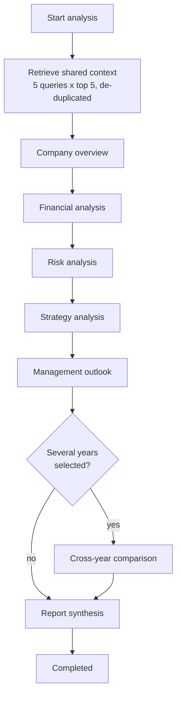

# InvestiLens 🔎📈

**AI-powered investor intelligence platform: upload annual reports, get cited answers and structured research reports, all running locally.**

InvestiLens turns long financial PDFs (annual reports, 10-Ks) into something you can interrogate. It indexes each document with a **Retrieval-Augmented Generation (RAG)** pipeline, then uses a **local LLM (Ollama)** to produce a multi-stage company analysis, a synthesized intelligence report, and a chat assistant whose answers are backed by **verifiable citations (document, page, quote)**.

Nothing leaves your machine: embeddings run on CPU through Hugging Face, the vector store is a local ChromaDB, and the language model is served by Ollama.

---

## Table of Contents

1. [Key Features](#-key-features)
2. [How It Works](#-how-it-works)
3. [The RAG Pipeline](#-the-rag-pipeline)
4. [The LLM Layer](#-the-llm-layer)
5. [Analysis Pipeline & Report](#-analysis-pipeline--report)
6. [Chat Assistant](#-chat-assistant)
7. [Tech Stack](#-tech-stack)
8. [Project Structure](#-project-structure)
9. [Getting Started](#-getting-started)
10. [Configuration](#-configuration)
11. [API Reference](#-api-reference)
12. [Frontend](#-frontend)
13. [Design Decisions & Reliability](#-design-decisions--reliability)
14. [Disclaimer & License](#-disclaimer--license)

---

## 🌟 Key Features

### AI / RAG / LLM
- **Local-first AI stack** — Ollama (`qwen2.5:7b` by default) for generation and `BAAI/bge-base-en-v1.5` (Hugging Face) for embeddings. No cloud API keys.
- **PDF ingestion pipeline** — page-level text extraction (PyMuPDF), repeated header/footer removal, typographic normalization, section detection, and page-bounded chunking with overlap.
- **Metadata-rich vector store** — every chunk is stored in ChromaDB with company, year, document name/type, page number and detected section, so retrieval can be filtered and every answer can be traced back to a page.
- **Filtered semantic search** — similarity search with relevance scores, filtered by company, year or document type; balanced retrieval across several fiscal years.
- **Multi-stage analysis agents** — separate prompts and structured outputs for company overview, financial performance, risks, strategy and management outlook, plus an optional cross-year comparison.
- **Report synthesis** — the stage outputs are merged into one structured *Intelligence Report* (executive summary, financial insights, key risks, strategic outlook, evidence list, disclaimer).
- **Chat with your documents** — intent classification, retrieval, context building, conversation history, confidence level, suggested follow-up questions, and **citations verified against the retrieved chunks**.
- **Grounded-by-design prompts** — the system prompt forces the model to use only the supplied evidence, answer "Insufficient Evidence" when it cannot, separate facts from interpretation, and never invent numbers, pages or sources.
- **Robust structured output** — model replies are parsed into Pydantic schemas with JSON extraction, validation and safe fallbacks, so a malformed generation never crashes a request.

### Product
- **Company workspaces** — one workspace per company with documents, analyses, chat and reports.
- **Live analysis progress** — progress bar and current step while the pipeline runs, with automatic polling.
- **Analysis and Reports pages** — cross-company views of every run with status filters and risk summaries.
- **Full report viewer** — a dedicated page per completed analysis.
- **One-call reset** — wipe all companies, vectors and uploaded PDFs during development.

---

## 🧭 How It Works

```mermaid
flowchart LR
    A[Upload PDF] --> B[Extract pages<br/>PyMuPDF]
    B --> C[Clean + detect sections]
    C --> D[Chunk by page<br/>1000 chars / 120 overlap]
    D --> E[Embed<br/>bge-base-en-v1.5]
    E --> F[(ChromaDB<br/>+ metadata)]
    F --> G[Semantic retrieval<br/>+ filters]
    G --> H[Context builder<br/>numbered sources]
    H --> I[Ollama LLM<br/>qwen2.5:7b]
    I --> J[Structured JSON<br/>Pydantic validation]
    J --> K[Analysis, Report, Chat]
```



---

## 🧱 The RAG Pipeline

All RAG code lives in `backend/app/rag/`.

| Stage | Module | What it does |
|---|---|---|
| Extraction | `ingestion.py` | Reads each PDF page with PyMuPDF (page numbers start at 1), computes a file hash, orchestrates the whole ingestion run and returns page count, chunk count and hash. |
| Cleaning | `preprocessing.py` | Normalizes typographic characters, cleans whitespace, removes headers/footers that repeat across pages, and drops empty pages. |
| Section detection | `preprocessing.py` | Looks at the first 500 characters of a page and matches 19 financial-report patterns (Risk Factors, MD&A, Balance Sheet, Cash Flow, Liquidity, Strategic Outlook…); defaults to `General`. |
| Chunking | `chunking.py` | Never crosses a page boundary. Paragraphs are packed up to `CHUNK_SIZE` (1000 characters); the tail of each finished chunk (`CHUNK_OVERLAP`, 120 characters) is carried into the next. Each chunk gets a stable ID plus page and section. |
| Embeddings | `embeddings.py` | `HuggingFaceEmbeddings` with `BAAI/bge-base-en-v1.5` on CPU and normalized vectors (cosine similarity). Loaded once, lazily, behind a lock. |
| Vector store | `vectorstore.py` | Persistent ChromaDB collection `investilens_documents` through LangChain. Stores company, year, document name/type, page, section and chunk ID as metadata. |
| Retrieval | `retriever.py` | `retrieve()` for a single query, balanced per-year retrieval when several years are selected (at least 2 results per year, merged and re-ranked by score), and `retrieve_for_analysis()` which runs several queries and de-duplicates chunks. |
| Context | `context_builder.py` | Formats retrieved chunks as numbered source blocks (document, page, section, text) for the prompt, and builds the clean source list the UI shows. |

**Retrieval filters** are expressed as ChromaDB `where` clauses (`company`, `year`, `document_type`), combined with `$and` when more than one is given.

---

## 🤖 The LLM Layer

All LLM code lives in `backend/app/llm/`.

- **`model.py`** — a cached `ChatOllama` instance (`temperature=0.1` for consistent, factual output; up to 4096 generated tokens per call). Model name and base URL come from configuration.
- **`prompts.py`** — ten LangChain `PromptTemplate`s sharing one grounding system prompt:

  | Prompt | Purpose |
  |---|---|
  | `COMPANY_ANALYSIS_PROMPT` | Business model, products, market presence |
  | `FINANCIAL_ANALYSIS_PROMPT` | Metrics, insights, positive and warning indicators |
  | `TREND_ANALYSIS_PROMPT` | Performance trends over time |
  | `RISK_ANALYSIS_PROMPT` | Key risks with severity and supporting evidence |
  | `STRATEGY_ANALYSIS_PROMPT` | Strategic priorities and initiatives |
  | `MANAGEMENT_OUTLOOK_PROMPT` | Management's stated expectations |
  | `COMPARISON_PROMPT` | Cross-year / cross-period comparison |
  | `CHAT_PROMPT` | Conversational Q&A with citations, confidence and follow-ups |
  | `REPORT_SYNTHESIS_PROMPT` | Merges every stage into the final report |
  | `INTENT_PROMPT` | Classifies a question into one of 8 intents |

- **`chains.py`** — one function per task (`run_company_analysis`, `run_financial_analysis`, `run_risk_analysis`, `run_strategy_analysis`, `run_management_outlook`, `run_comparison`, `run_chat`, `classify_intent`, `synthesize_report`) all going through a single `_invoke_chain` helper.
- **`parsers.py`** — extracts a JSON object from raw model text (including replies wrapped in prose or code fences), validates it against the target Pydantic model, and returns a safe default when parsing fails.

### Guardrails built into every prompt
1. Use **only** the provided document evidence — no outside knowledge.
2. Answer **"Insufficient Evidence"** when the evidence does not cover a field.
3. **Never fabricate** financial values, page numbers, sources or statements.
4. Distinguish **facts** (stated in the documents) from **interpretations** (reasoned analysis).
5. Cite the source document and page whenever possible.
6. **Confidence describes evidence quality**, not an investment prediction.

---

## 🧪 Analysis Pipeline & Report

Triggered by `POST /api/analysis/start`, executed as a background task by `services/analysis_orchestrator.py`.



1. **Retrieval** — five broad queries (overview, financial performance, strategy/R&D, risks/competition/regulation, management outlook), top 5 each, merged into one de-duplicated evidence block.
2. **Agents** — each stage runs its own prompt over that evidence and returns a validated Pydantic object (a company-overview dictionary, `FinancialAnalysis`, `RiskAnalysis`, `StrategyAnalysis`, `ManagementOutlook`, optional `CrossYearComparison`).
3. **Synthesis** — the stage results are passed to the report prompt to produce the final report.
4. **Progress tracking** — status moves through `processing → analyzing → completed` (or `failed` with an error message), with a 0–100 progress value and a human-readable current step.

### Intelligence Report structure
`executive_summary`, `company_overview`, `business_model`, `products_and_services`, `market_presence`, `financial_performance`, `financial_insights`, `performance_trends`, `positive_indicators`, `warning_indicators`, `key_risks`, `strategic_outlook`, `management_outlook`, `cross_year_comparison`, `evidence`, `overall_summary` and a standard `disclaimer`. When the report is requested, `api/reports.py` completes it with the structured results stored on the analysis, so the page always has the company name, timestamp and detailed lists.

---

## 💬 Chat Assistant

`POST /api/chat/` runs this flow:

1. **Intent classification** — the question is classified into `company_overview`, `financial_analysis`, `trend_analysis`, `risk_analysis`, `strategy_analysis`, `management_outlook`, `comparison` or `general_document_question`.
2. **Retrieval** — top 5 chunks for the company, optionally filtered by `year` or `years`.
3. **Context** — chunks become numbered source blocks; prior turns are added as conversation history.
4. **Generation** — the LLM returns JSON: answer, evidence, confidence (`High` / `Medium` / `Low`) and suggested follow-up questions.
5. **Citation grounding** — every citation the model writes is matched back to the retrieved chunks. Document name, page and section are taken from the chunk's metadata (never from the model's own text), and citations that cannot be matched are discarded. If none survive, the retrieved sources are returned instead.
6. If nothing relevant is retrieved, the assistant says it could not find sufficient evidence instead of guessing.

> Page numbers are the PDF's physical page index (first page = 1), which may differ from the number printed on the page.

---

## 🛠️ Tech Stack

**Backend** — Python, FastAPI, Uvicorn, LangChain (`langchain`, `langchain-community`, `langchain-huggingface`, `langchain-ollama`), Ollama, Sentence-Transformers / Hugging Face embeddings, ChromaDB, PyMuPDF, Pydantic v2 + pydantic-settings.

**Frontend** — React 18, Vite, React Router v7, Axios, Recharts, Lucide React, date-fns, vanilla CSS.

---

## 📂 Project Structure

```text
InvestiLens/
├── backend/
│   ├── app/
│   │   ├── api/                  # FastAPI routers (companies, documents, analysis, chat, reports, reset)
│   │   ├── core/                 # Settings (config.py) and logging
│   │   ├── llm/                  # model.py, prompts.py, chains.py, parsers.py
│   │   ├── models/               # Company, Document, Analysis records
│   │   ├── rag/                  # ingestion, preprocessing, chunking, embeddings,
│   │   │                         # vectorstore, retriever, context_builder
│   │   ├── schemas/              # Pydantic schemas (chat, report, financial, risk, strategy...)
│   │   ├── services/             # analysis_orchestrator.py, db_service.py
│   │   ├── utils/
│   │   └── main.py               # FastAPI app, CORS, router registration
│   ├── data/
│   │   ├── chroma/               # Persistent vector database
│   │   └── documents/            # Uploaded PDFs
│   ├── .env.example
│   └── requirements.txt
└── frontend/
    ├── src/
    │   ├── components/           # ChatInterface, DocumentsManager, AnalysisDashboard, CompanyOverview, Navbar
    │   ├── pages/                # Dashboard, CompanyWorkspace, AnalysisPage, ReportsPage, ReportPage
    │   ├── services/api.js       # Axios API client
    │   ├── utils/                # useAllAnalyses hook, date helpers
    │   └── App.jsx               # Routes
    ├── package.json
    └── vite.config.js
```

---

## 🚀 Getting Started

### Prerequisites
- **Python** 3.10+
- **Node.js** 18+
- **[Ollama](https://ollama.com)** installed and running
- Enough RAM for a 7B model (about 8 GB free recommended)

### 1. Pull the language model
```bash
ollama pull qwen2.5:7b
```

### 2. Backend
```bash
cd backend
python -m venv venv

# Windows
venv\Scripts\activate
# macOS / Linux
source venv/bin/activate

pip install -r requirements.txt
cp .env.example .env        # Windows: copy .env.example .env

python -m uvicorn app.main:app --port 8000
```
API docs: `http://localhost:8000/docs`

The first request that needs embeddings downloads and loads `BAAI/bge-base-en-v1.5` (this can take a minute the first time).

> On Windows, avoid `--reload` while testing long analyses: a reload can leave an orphaned worker holding port 8000 and keep serving old code.

### 3. Frontend
```bash
cd frontend
npm install
npm run dev
```
App: `http://localhost:5173` (the frontend calls `/api`, which is proxied to the backend on port 8000).

### 4. First run
1. Create a company on the dashboard.
2. Upload a PDF and wait until its status is **indexed**.
3. Click **Run Analysis** once and follow the progress bar (a 7B model on CPU can take several minutes).
4. Open the report, or ask questions in the chat tab.

---

## ⚙️ Configuration

Set in `backend/.env` (defaults shown):

| Variable | Default | Description |
|---|---|---|
| `LLM_PROVIDER` | `ollama` | LLM backend |
| `LLM_MODEL` | `qwen2.5:7b` | Ollama model name |
| `LLM_BASE_URL` | `http://localhost:11434` | Ollama server URL |
| `EMBEDDING_MODEL` | `BAAI/bge-base-en-v1.5` | Hugging Face embedding model |
| `CHROMA_PERSIST_DIRECTORY` | `./data/chroma` | Vector database folder |
| `DOCUMENT_DIRECTORY` | `./data/documents` | Uploaded PDF folder |
| `TOP_K` | `5` | Chunks retrieved per query |
| `CHUNK_SIZE` | `1000` | Max characters per chunk |
| `CHUNK_OVERLAP` | `120` | Characters carried between chunks |
| `API_HOST` / `API_PORT` | `0.0.0.0` / `8000` | Server binding |
| `LOG_LEVEL` | `INFO` | Logging level |

Changing `EMBEDDING_MODEL`, `CHUNK_SIZE` or `CHUNK_OVERLAP` requires re-indexing: reset the data and upload the documents again.

---

## 📡 API Reference

All routes are prefixed with `/api`.

| Method | Route | Description |
|---|---|---|
| `GET` | `/companies/` | List companies |
| `POST` | `/companies/` | Create a company |
| `GET` | `/companies/{company_id}` | Get one company |
| `DELETE` | `/companies/{company_id}` | Delete a company and its documents/analyses |
| `GET` | `/documents/company/{company_id}` | List a company's documents |
| `POST` | `/documents/upload` | Upload a PDF (multipart) and index it in the background |
| `DELETE` | `/documents/{document_id}` | Delete a document record and its file |
| `POST` | `/analysis/start?company_id=…&years=…` | Start an analysis run |
| `GET` | `/analysis/company/{company_id}` | List a company's analysis runs |
| `GET` | `/analysis/{analysis_id}` | Get one run with progress and stage results |
| `GET` | `/reports/{analysis_id}` | Get the final intelligence report |
| `POST` | `/chat/` | Ask a question about a company's documents |
| `DELETE` | `/reset/` | Delete all companies, vectors and uploaded PDFs |

`POST /analysis/start` is rejected until at least one document is `indexed`, and returns the existing run instead of starting a second one while an analysis is already running for the same company.

---

## 🖥️ Frontend

| Route | Page |
|---|---|
| `/` | Dashboard — companies and overall statistics |
| `/company/:companyId/*` | Workspace — overview, documents, financials, trends, risk intelligence, chat |
| `/analysis` | Every analysis run across companies, filterable by status, with live progress |
| `/reports` | Completed reports across companies |
| `/report/:analysisId` | Full intelligence report |

---

## 🛡️ Design Decisions & Reliability

- **Non-blocking server** — LLM and retrieval calls are CPU/IO heavy and synchronous; they run in worker threads (`asyncio.to_thread`, synchronous endpoints) so the API keeps answering while an analysis runs.
- **Thread-safe lazy singletons** — the embedding model, LLM client and Chroma client/vector store are created once with double-checked locking.
- **Evidence-first answers** — prompts require evidence, and citations are verified against retrieved chunks before they reach the UI.
- **Fail-soft parsing** — JSON extraction, schema validation and defaults keep one bad generation from failing the whole run.
- **Duplicate-run and premature-run protection** — one active analysis per company, and no analysis before indexing has finished.
- **Local-first privacy** — documents, vectors and prompts stay on your machine.

---


## 📄 Disclaimer & License

InvestiLens provides AI-generated analysis of the documents you upload for research and educational purposes. It is **not investment advice**, and its output can contain errors; always verify important figures against the original documents.

Released under the MIT License.
